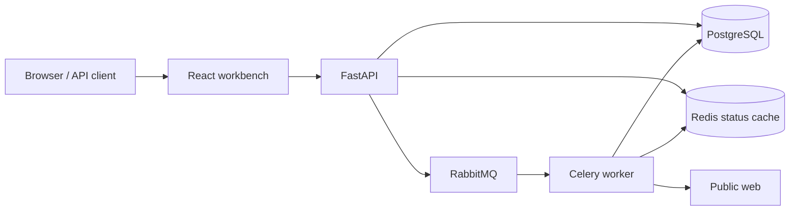

# Arachnin

**A secure web-ingestion boundary for retrieval-augmented generation systems.**

Arachnin turns a public web page into a clean, traceable document and a deterministic set of overlapping chunks. It exists for the unglamorous but important step between “we have a URL” and “this content is safe and useful to index.”

The system is intentionally small enough to understand end to end while still exercising production concerns: untrusted network input, asynchronous work, persistent state, cache failure, schema migrations, typed contracts, and observable progress.

## The problem

RAG demos often call a URL loader directly from an indexing script. That creates several problems once the workflow becomes a service:

- arbitrary URLs can expose internal services or cloud metadata;
- large, non-HTML, or redirecting responses can exhaust workers;
- navigation and advertising noise degrade retrieval quality;
- callers cannot track long-running ingestion or understand failures;
- extracted content lacks stable identity and source metadata;
- chunk boundaries change between ad-hoc implementations.

Arachnin owns that boundary. It validates every destination, bounds network reads, extracts the primary document, records provenance, hashes the result, and emits repeatable word-window chunks.

## What it demonstrates

| Concern | Implementation |
| --- | --- |
| Untrusted input | Public HTTP(S) validation, private/reserved IP blocking, credential rejection |
| Redirect safety | Every redirect destination is resolved and revalidated |
| Resource control | Timeouts, HTML-only responses, redirect cap, 5 MB streaming limit |
| Async execution | FastAPI → RabbitMQ → Celery worker with late acknowledgement |
| State | PostgreSQL as source of truth; Redis as a disposable status cache |
| Data contracts | Pydantic request/result models and generated OpenAPI documentation |
| Retrieval output | Clean text, metadata, SHA-256 identity, configurable overlapping chunks |
| Operations | Health-gated Compose services, non-root containers, Alembic migrations |
| Quality | Unit/API tests, coverage gate, Ruff, frontend build, dependency scanning |

## Architecture



PostgreSQL is authoritative. A Redis outage slows status reads but does not lose jobs. RabbitMQ separates request latency from network and extraction work. The worker performs network validation again because queue delay creates a new trust boundary.

## Result contract

```json
{
  "job_id": "860a071e-6ad7-4b16-8a77-d1df726cf76c",
  "status": "COMPLETED",
  "metadata": {
    "title": "Designing reliable retrieval pipelines",
    "canonical_url": "https://example.com/engineering/retrieval",
    "language": "en",
    "content_hash": "e06f...c44a",
    "word_count": 1842
  },
  "content": "...",
  "chunks": [
    { "index": 0, "text": "...", "word_count": 500 }
  ]
}
```

## Run locally

Requirements: Docker Engine with Compose v2.

```bash
cp .env.example .env
docker compose up --build
```

Then open:

- Workbench: <http://localhost:3000>
- OpenAPI: <http://localhost:8080/api/docs>
- RabbitMQ management: <http://localhost:15672>

Change the example passwords before exposing any service outside your machine. PostgreSQL and Redis are intentionally not published to the host.

## API workflow

Submit a document:

```bash
curl -X POST http://localhost:8080/api/v1/ingestions \
  -H "Content-Type: application/json" \
  -d '{"url":"https://example.com/article","chunk_size":500,"chunk_overlap":50}'
```

Poll and retrieve:

```bash
curl http://localhost:8080/api/v1/ingestions/{job_id}
curl http://localhost:8080/api/v1/ingestions/{job_id}/result
```

The API returns `202` when a job is accepted, `409` when a result is requested before completion, structured `422` errors for unsafe destinations, and `503` when work cannot be queued.

## Development

Backend:

```bash
cd backend
python -m venv .venv
source .venv/bin/activate  # Windows: .venv\Scripts\activate
pip install -e ".[dev]"
ruff check .
pytest
```

Frontend:

```bash
cd frontend
npm ci
npm run build
npm run dev
```

Database migrations:

```bash
cd backend
alembic upgrade head
alembic revision --autogenerate -m "describe change"
```

## Deliberate tradeoffs

**Word windows instead of model tokens.** Word counts are deterministic and model-independent. Production consumers may replace this with tokenizer-aware chunking at the cost of coupling ingestion to an embedding model.

**Polling instead of WebSockets.** Jobs progress through a handful of coarse states. Short polling keeps the failure model and deployment topology simple; server-sent events would be the next step if progress became more granular.

**DNS validation without IP pinning.** Arachnin rejects non-global resolutions before every request and redirect. A hardened internet-facing deployment should additionally pin the validated address during connection to close the DNS-rebinding gap, and should enforce egress policy at the network layer.

**Single-document jobs.** Batch and sitemap ingestion are intentionally outside the first release. The API and worker model can support them, but adding them before operating the single-document path would obscure the core reliability work.

## Failure model

| Failure | Behavior |
| --- | --- |
| Redis unavailable | Status reads fall back to PostgreSQL |
| RabbitMQ unavailable | Submission fails explicitly with `503`; job records the failure |
| Worker lost mid-task | Late acknowledgement allows the broker to redeliver |
| Remote timeout | Bounded retries with backoff, then a stable error code |
| Non-HTML or oversized content | Rejected before extraction |
| Extraction yields no useful text | Job fails without indexing low-quality content |

## Current limits

- JavaScript-rendered pages are not executed.
- Authentication-gated content is not supported.
- DNS rebinding should also be mitigated with production egress controls.
- Robots.txt and publisher-specific crawl policies are the deployer’s responsibility.
- The built-in chunker does not estimate embedding-token counts.

These are constraints, not hidden claims. They define where the next engineering work belongs.

## Repository map

```text
backend/
  app/api/          HTTP contracts and routes
  app/services/     network boundary and extraction logic
  app/worker/       asynchronous execution
  migrations/       reversible database history
  tests/            API, extraction, and security tests
frontend/
  src/              React ingestion workbench
docs/
  architecture.md   deeper design and threat model
```

## License

MIT — see [LICENSE](LICENSE).
